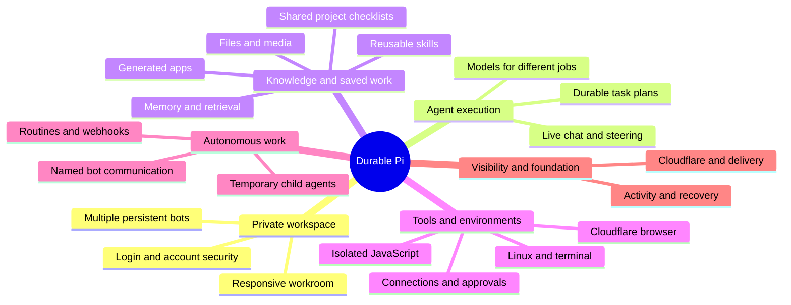
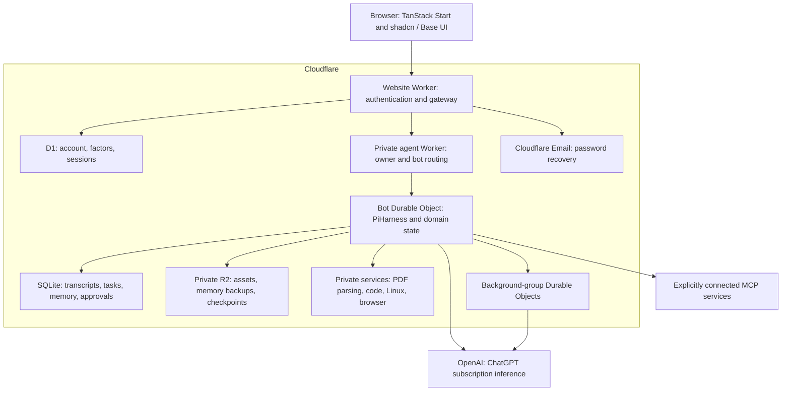
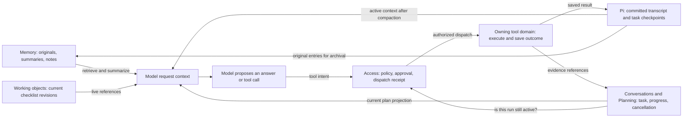
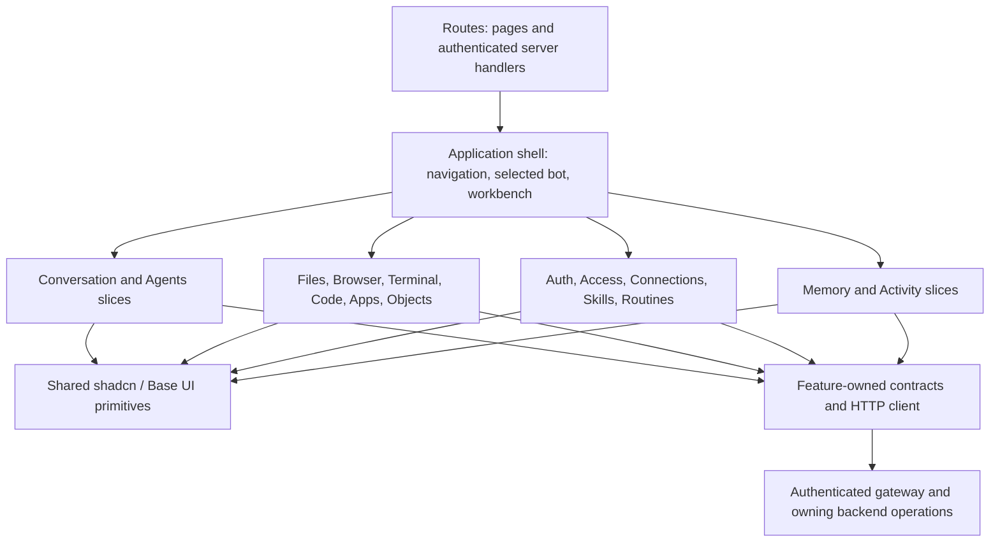
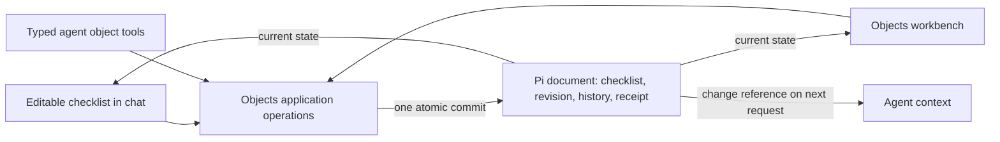

# Durable Pi — feature map

Durable Pi is a private workspace where you can talk to persistent bots, give them tools, and maintain saved work together. The application runs on Cloudflare. Model inference uses your separate ChatGPT subscription connection.

This map describes the implemented product as of **October 11, 2026**, checked against main `d78f774`. Open the app at [bot.cill-i-am.com](https://bot.cill-i-am.com).

Start with the diagrams to understand how the system fits together. Use the numbered feature inventory to find a capability, its controls, and its limits. The [verification map](#verification-map) separates hosted checks from local/native tests. All 20 capability areas are deployed, but that does not mean every interaction has been exercised in production. Later delivery entries supersede historical “next” or “pending” notes in the build log and `todo.md`.

## Product at a glance



## How the application fits together

The browser renders the workspace. The website Worker checks your session and forwards authenticated requests to a private agent Worker. That Worker resolves the owning bot before accessing its Durable Object: a Cloudflare instance with persistent SQLite storage and a lifecycle that can resume unfinished work.

The agent uses private service bindings to reach execution environments. Model inference and any MCP services you explicitly connect sit outside Cloudflare. MCP is the Model Context Protocol, which lets an agent discover and call tools supplied by another service.



Arrows show requests or storage access, not unrestricted access. The browser does not receive model credentials. Generated code receives only the input and capabilities provided by its execution environment. See the [Alchemy stack](alchemy.run.ts) and [authenticated gateway](src/routes/api.agent.$.ts).

## Backend domains: who owns each decision

A **domain** groups the rules and durable records for one responsibility. These domains share a host where appropriate; each domain is not a separate Worker or microservice. `PersonalAgent` wires their operations, storage adapters, Pi hooks, and lifecycle jobs together.

| Domain | Owns | Main implementation |
| --- | --- | --- |
| Identity | Who can sign in, session validity, second factors, and password recovery | [`src/auth`](src/auth), D1 |
| Agents | Bot identity, instructions, owner catalog, and archive state | [`src/agents`](src/agents), SQLite |
| Conversations | Turn identity, admission, steering, cancellation, and committed conversation projection | [`src/conversations`](src/conversations), SQLite and native Pi submissions |
| Planning | Logical task plans, progress, evidence references, and revision history, under the run's authority | [`src/planning`](src/planning), native Pi documents |
| Memory | OptChat originals, summaries, sourced notes, retrieval, and memory backups across tasks | [`src/memory`](src/memory), SQLite and R2 |
| Access | Tool policies, approvals, dispatch claims, and saved tool-call receipts | [`src/access`](src/access), SQLite |
| Inference | Available models, job routing, pinned run settings, and reported usage | [`src/inference`](src/inference), composed with Pi by the host |
| Workspace and Skills | Private assets, prepared media, skill documents, and selected skill revisions | [`src/workspace`](src/workspace), [`src/skills`](src/skills), SQLite and R2 |
| Working objects | Authoritative checklist state, targeted edits, conflicts, and change history | [`src/objects`](src/objects), native Pi documents |
| Apps | Generated definitions, published versions, private app state, and interaction events | [`src/apps`](src/apps), SQLite and isolated rendering |
| Browser, Execution, and Terminal | Tool-specific sessions, outcomes, cancellation, resource limits, and workspace checkpoints | [`src/browser`](src/browser), [`src/execution`](src/execution), [`src/terminal`](src/terminal) |
| Routines and Webhooks | Schedules, incoming-event receipts, trigger deduplication, and pause state | [`src/routines`](src/routines), [`src/webhooks`](src/webhooks), SQLite and lifecycle jobs |
| Delegation and Communication | Temporary child groups, named-bot task delivery, and correlated reports | [`src/delegation`](src/delegation), [`src/communication`](src/communication), Pi documents and SQLite |
| Activity | Readable projections and links back to the domain that can resolve an issue | [`src/activity`](src/activity); it does not own a second execution queue |

### Memory, run state, and model context

**Model context** is the information sent with one model request. It combines a bounded memory view, the active Pi transcript, and request-only references to plans and working objects. It is not the source of truth for whether an action ran or whether the bot may perform it.



Pi compaction changes the active transcript view while keeping older entries in storage. Memory preserves original records for retrieval across turns. Planning refers to saved evidence; it does not replace that evidence. Access checks durable permissions and the run's status before dispatch. A memory summary, plan, or retrieved document cannot supply an approval.

The application retains these owners rather than creating a separate “context database.” Request hooks assemble projections; native Pi documents and domain receipts remain authoritative. The [focused boundary review](BUILD.md#memory-run-state-and-model-context-review--2026-10-11) records the caller trace, bounded request projections, retained ownership and verification limits.

## Frontend feature slices: how the UI is organized

A **feature slice** keeps one UI capability's components, forms, queries, and local state together under `src/features/<capability>`. Its `index.ts` exposes the parts the application shell needs. Shared buttons, dialogs, menus, and other primitives live in `src/components/ui`.

The route and application layers compose slices. A frontend slice can display several backend domains: Activity, for example, presents plans, model usage, delegation, and mailbox tasks. Conversely, a checklist appears in both chat and Objects while using one object store and one backend operation.



The shell owns navigation and pending-draft fences. Feature state handles display, editing, and uncertain responses; it does not grant access or become a second durable record. The backend validates mutations even when the UI has already checked them. See [workspace composition](src/app/workspace.tsx), [feature entrypoints](src/features), and [shared primitives](src/components/ui).

## What happens when you send a request

The conversation runner admits work before waking Pi. Pi can then resume from durable submissions and task checkpoints if the host restarts. Streaming the result to the browser is separate from keeping the work alive.

```mermaid
sequenceDiagram
    actor Owner
    participant UI as Workspace UI
    participant Gate as Authenticated gateway
    participant Run as Conversations and Pi
    participant Context as Memory, Plans, Objects
    participant Model as Subscription model
    participant Access as Access domain
    participant Tool as Owning tool domain
    Owner->>UI: Send request or steering
    UI->>Gate: Submit with stable operation ID
    Gate->>Run: Resolve owner/bot and admit input
    Run->>Context: Read relevant durable state
    Context-->>Run: Request projections and references
    Run->>Model: Bounded working context
    Model-->>Run: Answer or tool intent
    opt Model requests a tool
        Run->>Access: Check policy, run state, and prior receipt
        opt Policy requires approval
            Access-->>UI: Persisted approval for exact inputs
            Owner->>UI: Allow once or deny
            UI->>Access: Save decision
        end
        opt Dispatch is authorized
            Access->>Tool: Execute under durable identity
            Tool-->>Access: Saved outcome
            Access-->>Run: Tool result or existing receipt
            Run->>Model: Continue with committed result
        end
    end
    Run->>Context: Archive original entries; preserve domain records
    Run-->>UI: Stream and reload saved progress
```

If the outcome of an external action is uncertain, recovery must preserve that uncertainty. A missing result in model context is not proof that the action failed or never ran. The access and execution records govern replay; a plan update or Activity read does not dispatch another action.

## How saved work and autonomous work connect

An editable checklist has one authoritative document. UI edits and agent tools call the same Objects operations, which check the expected revision and save the change with its history and retry receipt.



Checking a task does not start a model run. Generated apps behave differently: a published app interaction can save app state and queue an event for its owning bot. These are separate product capabilities, not two editable copies of the same record.

Autonomous work enters through explicit admission paths. Each path retains its own identity, limits, cancellation, and delivery records:

| Entry point | What starts or resumes | Where the outcome appears |
| --- | --- | --- |
| User request or steering | An ordinary turn or input to its active run | Chat and Activity |
| Scheduled routine or authenticated webhook | A bounded turn for the owning bot | That bot's chat and Activity |
| Published-app interaction | An event queued for the owning bot | App state and a later bot turn |
| Foreground delegation | Temporary children owned by the active request | One combined tool result and Activity details |
| Background delegation | Temporary tool-free child work that can outlive the parent's normal reply | A correlated internal report turn |
| Named-bot communication | An explicit text task for another existing bot | Durable mailbox status and a correlated result in the original bot |

Rebuilding model context, reading memory, editing a checklist, updating a plan, or inspecting Activity does not independently authorize an external action. Domain reads can still perform internal bookkeeping, such as evidence revalidation; that is distinct from dispatching work.

## Feature inventory

Each area below lists what you can do, where to find it, and the limits that affect its use.

### 1. Workspace and navigation

**Where:** main application shell.

- Paper's Quiet Workroom design implemented with TanStack Start, React, shadcn/Base UI, Geist typography, semantic theme tokens and agent marks.
- Desktop bot sidebar, conversation and optional contextual workbench; compact Agent / View / Tools menus and personal menu.
- Cmd/Ctrl+K searches bots and navigation commands. Conversation content search lives in Memory.
- Primary workbench tabs: **Browser, Terminal, Files, Apps, Activity**. **More** contains **Objects, Memory, Code, Routines**. Bot controls also expose models, skills, connections and tool access.
- Mobile Agents / Chat / Workspace navigation, responsive drawers, keyboard focus handling, reduced motion, and preservation of drafts and pending-save recovery across pane/viewport changes.

Sources: [application shell](src/app), [UI fidelity record](UI_FIDELITY.md).

### 2. Login and account security

**Where:** access screens and **Personal → Account security**.

- Private owner setup, password sign-in and sign-out; registration closes after the configured owner exists.
- Forgot/reset password through Cloudflare Email, single-use expiring links, enumeration-resistant responses, rate limits and session revocation after reset.
- Optional Better Auth authenticator two-factor authentication: QR setup, verified enrollment, sign-in challenge and encrypted single-use recovery codes.
- Password-confirmed factor management, replacement recovery codes and removal of two-factor protection. Password reset preserves an enabled second factor.
- Browser-session list with current-session marker, creation/expiry information, individual revocation and sign-out of all other sessions. Entries represent sessions, not verified physical machines.
- Revocation checked for HTTP, streaming conversation connections and interactive terminals. Signing out does not cancel durable agent work or revoke the separate ChatGPT connection.

**Boundary:** the feature is available; it does not mean the owner has enabled 2FA. There is no remembered-device bypass.

Sources: [authentication backend](src/auth), [access UI](src/features/auth).

### 3. Multiple persistent bots

**Where:** sidebar, Agent menu and bot settings.

- Create, rename, edit instructions, select, archive and restore bots; retain selection on refresh.
- Each bot has isolated conversations, memory, assets, objects, apps, routines and task state. The original bot retains its existing history.
- Per-bot skill revisions, model/job defaults, selected external tools, tool policies and browser destinations.
- Owner-wide catalog and credential-refresh coordination, with authenticated bot routing and archive admission fences.

**Boundary:** bots do not implicitly share their files, objects, memory or permissions. Named-bot communication transfers only explicitly supplied text.

Sources: [Agents context](src/agents), [bot UI](src/features/agents).

### 4. Live conversations and steering

**Where:** chat.

- Streaming text, exposed thinking events, tool calls/results and durable approval states; Markdown rendering and attachment cards.
- Send an idle turn, steer an active run at a tool boundary, or queue a separate follow-up. Text and supported attachments participate in durable admission.
- Stop, interruption recovery and retry-safe submission identities; uncertain acknowledgements do not require inventing another turn.
- Reconnect to saved progress, inspect earlier requests/results and preserve delivery order. Queued turns have appropriate scroll anchoring without pulling someone away from older content they are reading.
- Saved original messages and tool results remain retrievable after context compaction. Thinking is retained privately in Pi history, not added to the searchable OptChat archive.

Sources: [Conversations context](src/conversations), [conversation UI](src/features/conversation).

### 5. Models for different jobs and working-context compaction

**Where:** model controls, bot defaults and Activity model records.

- ChatGPT subscription OAuth, server-side credential storage and a single refresh owner. There is **no API-key fallback**.
- Account-aware model discovery and capability checks for reasoning effort, images and tools; unavailable choices fail explicitly.
- Per-job defaults for conversation, implementation, planning, review, labels, extraction and memory. Per-message Auto / Fast / Balanced / Deep profiles and advanced higher reasoning effort.
- Route, effort, policy version and verified context budget stay pinned through steering, recovery and retries; settings changes affect new work.
- Independent OptChat summary routing with bounded attempts, durable failures and explicit retry using the current memory setting.
- Native Pi compaction for long active runs; originals and tool relationships remain available. The recorded 272k connection budget uses a 112k compaction threshold, 160k reserve and roughly 20k recent-token retention. Other budgets derive their policy from the selected model.
- Activity reports actual requested/reported models, purpose, duration, outcome and provider input/cached/output tokens. Unknown usage stays unknown.

**Boundary:** OpenAI server-side compaction is not enabled. Public API maximum windows are not treated as subscription entitlement. The transport does not enforce a hard output-token cap. No API-dollar estimates or universal model-quality ranking are presented.

Sources: [inference policy](src/inference), [native compaction policy](src/agent/compaction.ts), [02c/02d/02e evidence](BUILD.md#02c--native-working-context-compaction-1).

### 6. Automatic durable task planning

**Where:** normal agent execution and **Activity**.

- Substantial requests can maintain objectives, constraints, observable completion criteria, steps, statuses, next action and blockers through `update_plan` / `read_plan`.
- Plans bind to the correct bot and logical task; steering belongs to its root task, and later work can explicitly continue or start a task.
- Current plan context is supplied on model requests without accumulating repeated full-plan messages. Native Pi documents retain revisions and recover across compaction/restart.
- Evidence references are checked against owned tool/execution receipts, files, apps and working objects. Source validation is distinct from an agent's claim that the outcome is complete.
- Changed requirements or invalidated evidence can reopen steps. Activity exposes progress, evidence and history without requiring the user to manage the plan.

**Boundary:** plans grant no permissions, schedule no actions and cannot restart cancelled work. Simple chat requires neither a plan nor a plan-approval interaction.

Sources: [Planning context](src/planning), [Activity UI](src/features/activity).

### 7. Long-term memory, search and recovery

**Where:** **Memory** and the agent's memory tools.

- OptChat-style immutable original-message/tool archive, hierarchical summaries and a stable bounded context view between turns.
- Exact text search, `zoom` into original ranges and `date` lookup; inspect summary provenance down to source messages.
- Sourced Markdown notes with revision history, maintained through agent tools. The UI inspects notes and their sources.
- Incremental binary summary merges, persisted work/retry state, independent summary-model policy and visible recovery for paused summary ranges.
- Stable prompt-cache keys and memory breakpoints; actual cache-use reporting rather than assuming every request receives cache hits.
- Private HTML/JSONL exports and idempotent history import that preserves dates without executing imported text.
- Incremental private R2 backups with hashes, complete manifests and last-backup status; restore tooling verifies integrity into a new local SQLite database.

**Boundary:** memory backup is not a complete account/application backup. Replacement production-DO restoration requires an operator-controlled migration. Automatic scheduled “dreaming” is not implemented; the UI has no direct note editor.

Sources: [Memory context](src/memory), [memory design and recovery](README.md#memory-design).

### 8. Private files, documents and media

**Where:** composer and **Files**.

- Private per-bot uploads, file listing, rename, previews, download, recoverable Trash and restore; safe paths, ownership checks and retry-safe upload identities.
- Attach images and text to turns/steering. Preserve original images while deriving bounded JPEG inputs for supported vision models.
- Background PDF text extraction in a private Worker; page-labelled text, coverage/truncation reporting, explicit failure/retry states and retrieval tools.
- MP4/WebM preparation in an isolated container: up to six timestamped frames plus supported embedded text captions. Preview what the model will receive and preserve the original video.
- Text-range file reading by the agent; transfer files into and out of the terminal workspace.

**Boundary:** the collection is flat. No scanned-PDF OCR, audio transcription, image-subtitle OCR, native video inference or point/region asset annotations. Videos are limited to 8 MB and ten minutes; sampled frames can miss intervening events. At most four attachments enter a reply, including steering.

Sources: [Workspace context](src/workspace), [Files UI](src/features/files), [media limits](README.md#video-attachments).

### 9. Reusable skills

**Where:** **Skills**.

- Private owner library with creation, editing, Markdown import, immutable revisions, history, archive and restore.
- Each bot pins up to four explicit revisions. Edits offer an update rather than silently changing existing selections; running turns retain their captured selection.
- Executor import via an explicitly connected provider: browse an app's catalog, preview a pinned `SKILL.md`, save a local revision and retain source metadata.
- Draft-preserving conflict resolution, retry-safe saves and restoration of an earlier version as a new revision.

**Boundary:** an import copies the main `SKILL.md`, not every referenced file. Reading provider references needs the selected external tool. Instructions never grant tool access; saved copies remain usable after disconnecting.

Sources: [Skills context](src/skills), [Skills UI](src/features/skills).

### 10. Persistent working objects: project checklists

**Where:** editable cards in chat and **Objects**.

- Agent or owner creates a project checklist with stable task IDs, To do / In progress / Blocked / Done statuses, optional due dates and notes.
- Chat and workbench edit the same authoritative Pi document through shared application operations; neither transcript nor memory is a second editable copy.
- Targeted revision-checked edits, explicit stale-write conflicts, preserved drafts, idempotent mutation receipts and recovery of unconfirmed saves.
- Readable user/agent history, original-conversation links, archive/restore and durable change indicators for the agent's next request.
- Typed `list_objects`, `read_object`, `create_checklist` and `update_checklist` tools; changes survive reconnects/restarts without launching a model for every checkbox click.

**Boundary:** project checklist is the only structured working-object type so far. A checked task records status, not independently verified external work. Other object types and a generic database builder are not built.

Sources: [Working objects context](src/objects), [object UI](src/features/objects).

### 11. Generated apps and inline UI

**Where:** **Apps** and published-app cards in chat.

- Agent-authored text, metrics, tables, checklists and forms using a bounded renderer, with durable app state.
- Immutable draft versions, private publication, version preview/republishing, archive/restore and original publication references.
- Published interactions save state and queue an event for the owning bot through normal conversation permissions.
- Custom web apps execute server-side JavaScript in a private Cloudflare Dynamic Worker, returning bounded HTML, CSS and JSON state.
- Isolated browser frame, trusted button/form bridge, state conflicts, mutation deduplication and explicit treatment of unsaved or unconfirmed changes.

**Boundary:** apps remain owner-private. Generated JavaScript does not execute in the browser; arbitrary client frameworks, CDN dependencies, network access and public sharing are not supported. Republish restores a definition, not historical form answers. Apps and persistent working objects have separate purposes and authoritative stores.

Sources: [Apps context](src/apps), [Apps UI](src/features/apps).

### 12. External connections, tools and approvals

**Where:** **Connect**, **Tools**, inline approval cards and Activity.

- Explicit trusted HTTPS MCP connections over Streamable HTTP, including supported OAuth sign-in/public registration and anonymous endpoints.
- Select tools per bot; server-enforced **Allow / Ask / Deny** policy and exact-input one-time approvals.
- Persisted approval receipts across reload/restart, clear denied/expired/cancelled/interrupted outcomes, and a guard before external effects.
- Disconnect/revocation blocks future use; reconnect invalidates old selections. Credentials remain private server state.
- The same authority applies to ordinary tools, routines and supported delegation. Planning, imported skills and incoming content cannot create permissions.

**Boundary:** no external service is connected automatically. Arbitrary auth headers and bearer credentials in URLs are unsupported. An already dispatched external effect may complete; interrupted results require reconciliation before another action.

Sources: [Access context and tool inventory](src/access), [connection UI](src/features/connections), [approvals UI](src/features/access).

### 13. Cloudflare browser

**Where:** **Browser** and `browser_open` / `browser_read` / `browser_interact`.

- Private per-bot Chromium sessions on Cloudflare Browser Rendering, with bounded page text, links and screenshots.
- Owner-managed exact-hostname destinations with runtime network guardrails, or an explicit unrestricted-internet setting for public HTTP(S) sites. Changing the policy closes the old session and fences its results.
- Bot click/type/key/scroll actions tied to a recent capture; normal tool approvals remain in force.
- Human takeover pauses bot browser tools; private owner input and return-control preserve the same session and cookies.
- Session expiry, close/revoke, cleanup recovery and fencing of stale in-flight results.

**Boundary:** this is screenshot-based interaction, not a live video browser. Sessions have two-minute idle and ten-minute total limits. Unrestricted access removes the site allowlist; it does not permit arbitrary scripts, warning bypasses, embedded URL credentials, or non-web URL schemes. Sensitive/custom embedded inputs have restrictions. Kitesurf remains deferred.

Sources: [Browser context](src/browser), [Browser UI](src/features/browser).

### 14. Isolated JavaScript execution

**Where:** **Code** and `run_code`.

- Run JavaScript with explicit JSON input, logs and result through Cloudflare Dynamic Workers.
- Per-bot saved run history, stable request IDs, result replay, cancellation and interrupted-state reporting.
- No network, filesystem, application bindings or model credentials inside generated code.
- Bounded code/input/output, one active run, one-second CPU and ten-second elapsed budgets.

**Boundary:** an interrupted run is not automatically re-executed. This environment is separate from the Linux terminal.

Sources: [Execution context](src/execution), [Code UI](src/features/execution).

### 15. Linux terminal and workspace files

**Where:** **Terminal** → Commands / Interactive / File transfer, and `run_command`.

- Node, Python and shell commands in isolated Cloudflare Sandbox containers, with streaming output, cancellation, deadlines and saved receipts.
- Private R2 checkpoints preserve `/workspace` between command containers; failed/uncertain saves keep the previous checkpoint. Cleanup failures block new commands until resolved.
- Interactive terminal with input/output, resize, Ctrl+C, reconnect buffer, authenticated lease and explicit Save and close / Discard and stop.
- Copy private assets into an isolated import folder, prepare exact-byte exports, download them or add supported exports back to Files.
- Replay-safe transfers, cancellation receipts and checks against path escape, symlinks and special files.

**Boundary:** outbound networking is disabled by default. The owner can enable unrestricted internet in this bot’s Terminal settings, including for interactive sessions. Changes require an idle, cleaned-up terminal; each command retains its admitted network policy. Tool permissions still apply. Commands share checkpointed files, not persistent processes or shell environment. Interactive sessions are leased and limited to ten minutes; lost authorization/lease stops them without saving. Files outside the retained workspace and excluded directories are not checkpointed.

Sources: [Terminal context](src/terminal), [Terminal UI](src/features/terminal), [checkpoint and transfer behavior](README.md#linux-command-workbench).

### 16. Scheduled routines and incoming events

**Where:** **Routines**, agent routine tools and webhook settings.

- One-off and elapsed-interval schedules, event-only routines, Run now, pause, stop, archive and restore paused.
- Cloudflare alarms admit work while the app is closed, with bounded runs, deduplication and coalescing of missed intervals.
- Results enter the owning conversation under existing model/tool settings and permissions; model unavailability remains visible waiting state.
- Authenticated JSON webhook endpoints, one-time-visible private keys, rotation/disable, stable event IDs, conflicting-replay rejection and durable receipts.
- Conflict-aware editing and recovery of uncertain saves.

**Boundary:** no automatic email/push notifications, calendar/timezone recurrence rules or vendor-specific signature adapters. Repeat schedules follow elapsed time across daylight saving. Only one routine waits/runs per bot at a time.

Sources: [Routines context](src/routines), [Webhooks context](src/webhooks), [Routines UI](src/features/routines).

### 17. Temporary child-agent delegation

**Where:** `delegate_tasks` / `background_tasks` and Activity delegated-work inspector.

- Foreground groups of up to three research/drafting children with separate durable Pi conversations and explicit read-tool subsets.
- Foreground children inherit the parent's pinned model/context budget; parent steering and cancellation retain authority.
- Background groups of up to three text-only drafting/analysis children with no tools, immutable context/model pins and a separate private Durable Object.
- Parent can finish while background work continues; a correlated internal report returns through normal durable admission without requiring an open browser.
- Inspect briefs, status, reports, usage and child transcripts; steer/stop with durable control identities and recover report delivery after interruption.

**Boundary:** no recursive spawning. Foreground children cannot modify objects/plans or perform browser, terminal or external actions; background children receive explicit text only. Child transcripts remain separate from parent memory, which receives the combined report.

Sources: [Delegation context](src/delegation), [Activity delegation UI](src/features/activity/delegated-work.tsx).

### 18. Communication between existing named bots

**Where:** `discover_bots` / `delegate_bot` / `check_bot_task` and **Activity → Bot communication**.

- Discover the owner's active bots and send a bounded question or drafting brief to a specific persistent bot, governed by the existing approval policy.
- Private Effect RPC over Durable Object bindings, durable SQLite inbox/outbox, committed acceptance receipts and stable delivery identities.
- Receiving bot runs in an isolated Pi conversation using its own instructions plus explicit brief. Result delivery resumes the originating logical request as an internal bot result.
- Inspect requester/recipient, status, deliveries, attempts, deadline, result/blocker and original request; cancel or safely retry delivery.
- Recover lost acknowledgements, process restarts and browser disconnects without duplicate task admission. Cancellation prevents a result from restarting cancelled work.

**Boundary:** currently text-only and one hop, up to three tasks per originating request and a ten-minute task deadline. Recipient has no tools, implicit file/object access or onward delegation. Delivery is at least once with deduplication; exactly-once inference or external effects are not promised. Awaiting input is a terminal outcome, not a polling loop.

Sources: [Communication context](src/communication), [mailbox UI](src/features/activity/bot-tasks.tsx), [delivery evidence](BUILD.md#bot-communication--durable-inbox-and-outbox-2026-10-11).

### 19. Activity and actionable recovery

**Where:** per-bot or global **Activity**, linked domain panels.

- Owner-scoped timeline with Needs you / Running filters, stable paging and explicit partial-read failures.
- Saved requests, answers, steering, thinking and committed tool input/results, with internal report origins identified separately.
- Automatic plans/evidence, model attempts/usage, temporary child groups and named-bot tasks in dedicated inspectors.
- Links to existing approval, memory-summary, backup, connection and execution recovery controls rather than a generic retry-all action.
- Deterministic recovery for repeated failed tool calls: warning after three matching failures, then at most three further non-polling recovery attempts; a fifth matching failure or spent allowance stops the run. Activity shows progress, blockers and saved receipt references.
- Native replay does not count twice. Denials and uncertain actions stop without bypass advice; polling and approval waits remain normal. A successful recovery call is execution progress, not proof of completed user goals.
- Inspection does not restart finished work, retry external effects or infer new permissions from historical events.

Sources: [Activity context](src/activity), [Activity UI](src/features/activity), [run recovery policy](src/conversations/recovery.ts), [native tool-round adapter](src/conversations/adapters/pi-recovery.ts).

### 20. Cloudflare foundation and delivery

**Where:** infrastructure, runtime and repository workflow.

- Cloudflare website/gateway Worker, private agent Worker and per-bot SQLite Durable Objects running PiHarness; private background-group DOs.
- D1 authentication/session/factor data; private R2 memory backups, uploaded assets and terminal checkpoints.
- Private document-processing and Dynamic Worker execution services, Sandbox Containers, Browser Rendering, Email and lifecycle alarms.
- Domain-oriented backend contexts with Effect application operations; feature-sliced frontend with shared shadcn/Base UI primitives.
- Alchemy-managed production infrastructure, canonical custom domain/TLS and encrypted deployment state. Existing storage/namespace identities are preserved.
- Public GitHub source, ignored private runtime data, secret scanning, PR checks and serialized automatic Cloudflare deployment after successful pushes to `main`; production secrets remain in GitHub's restricted environment.
- Meaningful domain, SQLite, Pi, workerd, browser and recovery tests, with independent review and a per-slice evidence ledger.

**Boundary:** application hosting/state/execution run on Cloudflare. OpenAI inference and explicitly connected MCP services are external. Public source does not make private chats, assets or generated apps public.

Sources: [Alchemy stack](alchemy.run.ts), [deployment workflow](.github/workflows/check.yml), [build architecture](BUILD.md#architecture-and-domain-ownership).

## Important distinctions

| Capability | What it owns | What it does not imply |
| --- | --- | --- |
| OptChat memory | Long-term originals, summaries, notes and retrieval between turns | The entire active run fits without compaction |
| Pi native compaction | Working context inside a run | Deletion of originals or server-side OpenAI compaction |
| Task plan | Agent progress, constraints, next action and evidence references | New permissions or automatic restart |
| Working object | A shared, authoritative editable checklist | Proof that a checked external action occurred |
| Generated app | Versioned interactive presentation and private app state | Public hosting or unrestricted generated code |
| Foreground children | Temporary request-owned research/drafting help | Independent persistent bots or unrestricted tools |
| Background children | Temporary tool-free jobs that report later | Permissions borrowed from a later conversation |
| Named-bot mailbox | Explicit text tasks between existing bots | Shared memory, files, objects or grants |
| Session revocation | Browser access to the application | Cancellation of agents or revocation of ChatGPT OAuth |

## Verification map

These are **recorded checks**, not a fresh complete acceptance run for this document. The latest implementation suite recorded **470 passing tests across 69 files**, plus typecheck, lint, build and native communication-runtime verification. The latest code deployment (`4acad80`) passed production checks; snapshot `d78f774` adds its evidence documentation.

| Area | Recorded hosted evidence | Local/native evidence and limits |
| --- | --- | --- |
| Access and security | Access boundaries, reset-send confirmation, signed-in session list and password-confirmed setup entry | Full TOTP/recovery-code/session-revocation journeys; owner's actual enrollment and inbox reset completion are not claimed |
| Workspace and visual fidelity | Deployed Paper slices, hosted access-screen/mobile checks, later signed-in workspace use | Desktop/mobile interaction, accessibility, conflicts and responsive drafts; not every authenticated visual state was rechecked hosted, and no physical iOS keyboard test |
| Chat, routing and memory | Subscription replies, profile changes, independent memory summaries, corrected-fact recall, replay and measured cache use | Steering, race/recovery/isolation tests; no exhaustive hosted long-prefix cache benchmark |
| Active-run compaction | Deployed and auth checks passed | Small-budget native runs, measured fixture summary overhead and actual workerd restart during compaction; no hosted long-running summary-quality check |
| Plans and checklists | Multi-step model-created plan/checklist, owner operation edit, later agent read, evidence revalidation, conflict/replay/isolation | Native restart, cancelled tasks, concurrent revisions and UI conflict/recovery coverage |
| Files, PDFs, video and skills | Deployed with authentication checks | Real local upload/parser/FFmpeg/service-binding and skill journeys; full hosted owner/model media and Executor-import journeys not claimed |
| MCP and approvals | Selected tool actions exercised through hosted product journeys | Native policy/receipt/OAuth and revocation coverage; no blanket verification of arbitrary external providers or owner account connections |
| Browser, JavaScript and apps | Browser capture/destination restrictions, isolated execution/replay and durable custom-app state; agent published/read an app | Human takeover/authenticated-session handoff and detailed permission/state-race cases verified locally |
| Linux and interactive terminal | Exact command output and checkpoint teardown/restore | Real workerd/container interactive shell, lease/revocation, transfer and failure-recovery tests; all interactive hosted paths not claimed |
| Routines and webhooks | Timed routine admitted independently before status polling | Webhook identity/authentication/deduplication and local scheduling/restart coverage; no blanket vendor integration test |
| Foreground/background children | Live subscription child results, correlated report, stable model pins, replay and usage | Interrupted native requests, saved steering, SQLite/workerd restart; forced hosted inference restart not performed |
| Named-bot communication | Real A → B → A result after browser disconnect; delivery receipts, preserved constraints and usage; initial failed delivery/deadline recovery | Actual two-DO workerd/SQLite RPC tests with forced process termination; no forced hosted restart during inference |
| Activity and recovery | Per-bot/global isolation, saved request/result inspection, no extra model requests on read | Paging, partial failures, recovery links and native replay/cancellation tests |
| Memory backup | Private R2 backup infrastructure is deployed; no fresh production backup/restore was run for this map | Integrity-checking restore targets a new local database; complete production account disaster recovery is outside this feature |

Detailed evidence: [BUILD.md](BUILD.md) and [UI_FIDELITY.md](UI_FIDELITY.md). This map makes no new production changes.

## Not built or deliberately outside the current scope

- Additional working-object types such as itineraries, decision registers or research collections.
- Point/region annotations for asset steering; native audio/video understanding, speech transcription and OCR.
- Public app sharing, multi-user collaboration and implicit cross-bot data sharing.
- Arbitrary client JavaScript/frameworks in generated apps.
- Richer named-bot tasks with tool grants, shared object/file capabilities, recursive delegation or open-ended agent swarms.
- Calendar/timezone recurrence, automatic external push/email outcome notifications and vendor-specific webhook signature adapters.
- Kitesurf integration, automatic memory dreaming and direct UI editing of memory notes.
- A one-click restore of the entire production account/application.

These boundaries describe the current build; they do not add new commitments to the roadmap.
