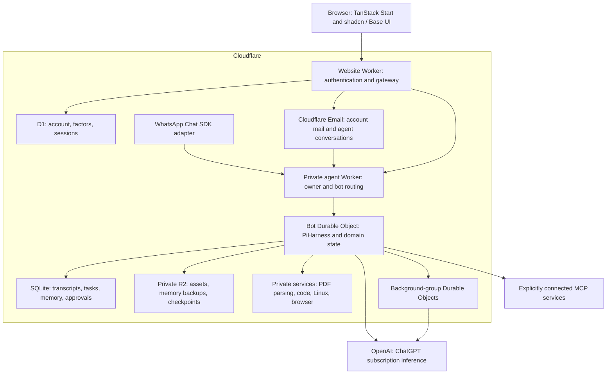
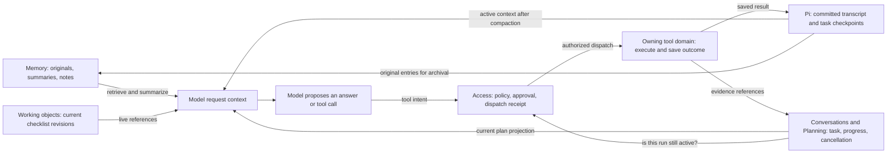
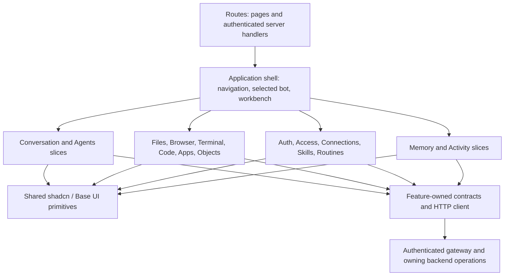
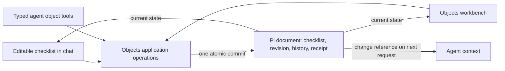

# Durable Pi architecture and ownership

This guide explains the product's source-of-truth boundaries at revision `a133e4b` (October 19, 2026). Start with the [feature map](../FEATURES.md) for user-visible capabilities and verification recipes. Domains are modules with durable ownership, not a requirement for one service per module.

The mandatory [XState Effect lifecycle standard](decisions/xstate-effect-state-machines.md) governs existing and future application-owned lifecycles, including frontend interaction/resource flows. XState through `@xstate/effect` owns states, events, guards and transitions; Effect owns work and live resource lifetimes; pure functions own computation. Pi owns durable agent/task execution and recovery, domain storage owns application records, Lifecycle owns durable wakes, and Access owns authorization. The [refactor inventory](xstate-effect-inventory.md) tracks implementation against that standard; the [release closeout](xstate-effect-release.md) records the completed migration at `b7b465c`.

## How the application fits together

The browser renders the workspace. The website Worker checks your session and forwards authenticated requests to a private agent Worker. That Worker resolves the owning bot before accessing its Durable Object: a Cloudflare instance with persistent SQLite storage and a lifecycle that can resume unfinished work.

The agent uses private service bindings to reach execution environments. Model inference and any MCP services you explicitly connect sit outside Cloudflare. MCP is the Model Context Protocol, which lets an agent discover and call tools supplied by another service.



Arrows show requests or storage access, not unrestricted access. The browser does not receive model credentials. Generated code receives only the input and capabilities provided by its execution environment. See the [Alchemy stack](../alchemy.run.ts) and [authenticated gateway](../src/routes/api.agent.$.ts).

## Backend domains: who owns each decision

A **domain** groups the rules and durable records for one responsibility. These domains share a host where appropriate; each domain is not a separate Worker or microservice. `PersonalAgent` wires their operations, storage adapters, Pi hooks, and lifecycle jobs together.

| Domain | Owns | Main implementation |
| --- | --- | --- |
| Identity | Who can sign in, family membership, shared model access, passkeys, second factors, and session validity | [`src/auth`](../src/auth), [`src/family`](../src/family), D1 |
| Agents | Bot identity, instructions, owner catalog, and archive state | [`src/agents`](../src/agents), SQLite |
| Conversations | Turn identity, admission, steering, cancellation, and committed conversation projection | [`src/conversations`](../src/conversations), SQLite and native Pi submissions |
| Planning | Logical task plans, progress, evidence references, and revision history, under the run's authority | [`src/planning`](../src/planning), native Pi documents |
| Memory | OptChat originals, summaries, sourced notes, retrieval, and memory backups across tasks | [`src/memory`](../src/memory), SQLite and R2 |
| Access | Tool policies, approvals, dispatch claims, and saved tool-call receipts | [`src/access`](../src/access), SQLite |
| Inference | Available models, job routing, pinned run settings, and reported usage | [`src/inference`](../src/inference), composed with Pi by the host |
| Workspace and Skills | Private assets, prepared media, skill documents, and selected skill revisions | [`src/workspace`](../src/workspace), [`src/skills`](../src/skills), SQLite and R2 |
| Working objects | Authoritative checklist state, targeted edits, conflicts, and change history | [`src/objects`](../src/objects), native Pi documents |
| Apps | Generated definitions, published versions, private app state, and interaction events | [`src/apps`](../src/apps), SQLite and isolated rendering |
| Browser, Execution, and Terminal | Tool-specific sessions, outcomes, cancellation, resource limits, and workspace checkpoints | [`src/browser`](../src/browser), [`src/execution`](../src/execution), [`src/terminal`](../src/terminal) |
| Routines and Webhooks | Schedules, incoming-event receipts, trigger deduplication, and pause state | [`src/routines`](../src/routines), [`src/webhooks`](../src/webhooks), SQLite and lifecycle jobs |
| Delegation and Communication | Temporary child groups, named-bot task delivery, and correlated reports | [`src/delegation`](../src/delegation), [`src/communication`](../src/communication), Pi documents and SQLite |
| Email, WhatsApp, and Replies | Transport admission, routing, complete reply plans, provider receipts, and channel recovery | [`src/email`](../src/email), [`src/whatsapp`](../src/whatsapp), [`src/replies`](../src/replies) |
| Tasks | Account-scoped status and exact cancellation over existing task records | [`src/tasks`](../src/tasks) |
| Activity | Readable projections and links back to the domain that can resolve an issue | [`src/activity`](../src/activity); it does not own a second execution queue |

### Memory, run state, and model context

**Model context** is the information sent with one model request. It combines a bounded memory view, the active Pi transcript, and request-only references to plans and working objects. It is not the source of truth for whether an action ran or whether the bot may perform it.



Pi compaction changes the active transcript view while keeping older entries in storage. Memory preserves original records for retrieval across turns. Planning refers to saved evidence; it does not replace that evidence. Access checks durable permissions and the run's status before dispatch. A memory summary, plan, or retrieved document cannot supply an approval.

The application retains these owners rather than creating a separate “context database.” Request hooks assemble projections; native Pi documents and domain receipts remain authoritative. The [focused boundary review](../BUILD.md#memory-run-state-and-model-context-review--2026-10-11) records the caller trace, bounded request projections, retained ownership and verification limits.

## Frontend feature slices: how the UI is organized

A **feature slice** keeps one UI capability's components, forms, queries, and local state together under `src/features/<capability>`. Its `index.ts` exposes the parts the application shell needs. Shared buttons, dialogs, menus, and other primitives live in `src/components/ui`.

The route and application layers compose slices. A frontend slice can display several backend domains: Activity, for example, presents plans, model usage, delegation, and mailbox tasks. Conversely, a checklist appears in both chat and Objects while using one object store and one backend operation.



The shell owns navigation and pending-draft fences. Feature state handles display, editing, and uncertain responses; it does not grant access or become a second durable record. The backend validates mutations even when the UI has already checked them. See [workspace composition](../src/app/workspace.tsx), [feature entrypoints](../src/features), and [shared primitives](../src/components/ui).

## What happens when you send a request

The conversation runner admits work before waking Pi. Pi can then resume from durable submissions and task checkpoints if the host restarts. Streaming the result to the browser is separate from keeping the work alive.

```mermaid
sequenceDiagram
    actor Owner
    participant UI as Workspace UI
    participant Gate as Authenticated gateway
    participant Run as Conversations and Pi
    participant Context as Memory, Plans, Objects
    participant Model as Subscription model
    participant Access as Access domain
    participant Tool as Owning tool domain
    Owner->>UI: Send request or steering
    UI->>Gate: Submit with stable operation ID
    Gate->>Run: Resolve owner/bot and admit input
    Run->>Context: Read relevant durable state
    Context-->>Run: Request projections and references
    Run->>Model: Bounded working context
    Model-->>Run: Answer or tool intent
    opt Model requests a tool
        Run->>Access: Check policy, run state, and prior receipt
        opt Policy requires approval
            Access-->>UI: Persisted approval for exact inputs
            Owner->>UI: Allow once or deny
            UI->>Access: Save decision
        end
        opt Dispatch is authorized
            Access->>Tool: Execute under durable identity
            Tool-->>Access: Saved outcome
            Access-->>Run: Tool result or existing receipt
            Run->>Model: Continue with committed result
        end
    end
    Run->>Context: Archive original entries; preserve domain records
    Run-->>UI: Stream and reload saved progress
```

If the outcome of an external action is uncertain, recovery must preserve that uncertainty. A missing result in model context is not proof that the action failed or never ran. The access and execution records govern replay; a plan update or Activity read does not dispatch another action.

## How saved work and autonomous work connect

An editable checklist has one authoritative document. UI edits and agent tools call the same Objects operations, which check the expected revision and save the change with its history and retry receipt.



Checking a task does not start a model run. Generated apps behave differently: a published app interaction can save app state and queue an event for its owning bot. These are separate product capabilities, not two editable copies of the same record.

Autonomous work enters through explicit admission paths. Each path retains its own identity, limits, cancellation, and delivery records:

| Entry point | What starts or resumes | Where the outcome appears |
| --- | --- | --- |
| Owner email or configured WhatsApp input | The same durable conversation and attachment preparation, with channel routing and receipts | Chat and the originating channel |
| User request or steering | An ordinary turn or input to its active run | Chat and Activity |
| Scheduled routine or authenticated webhook | A bounded turn for the owning bot | That bot's chat and Activity |
| Published-app interaction | An event queued for the owning bot | App state and a later bot turn |
| Foreground delegation | Temporary children owned by the active request | One combined tool result and Activity details |
| Background delegation | Temporary tool-free child work that can outlive the parent's normal reply | A correlated internal report turn |
| Named-bot communication | An explicit text task for another existing bot | Durable mailbox status and a correlated result in the original bot |

Rebuilding model context, reading memory, editing a checklist, updating a plan, or inspecting Activity does not independently authorize an external action. Domain reads can still perform internal bookkeeping, such as evidence revalidation; that is distinct from dispatching work.
